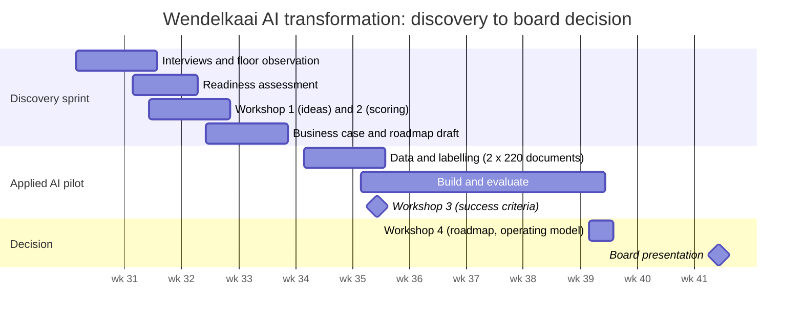

# Engagement approach

Twelve weeks from the first workshop to the board decision. Strategy and build run in one team, so the pilot answers the questions the business case raises and the business case uses what the pilot measured.

## Phases and what each one proves

| Phase | Deliverable | What it proves | Where |
|---|---|---|---|
| 1. Discovery | Stakeholder map, interview synthesis, workshop series, process maps | We understand the business before we talk about AI | [01-discovery](../01-discovery/) |
| 2. AI readiness | Maturity assessment (30 items, 6 dimensions), gap analysis, scorecard | We can judge an organisation, not just a technology | [02-ai-readiness](../02-ai-readiness/) |
| 3. Opportunity mapping | 10 use cases, scored and ranked, robustness test | Choices are made on criteria the client agreed, and they hold when weights move | [03-opportunity-discovery](../03-opportunity-discovery/) |
| 4. Business case | Cash and capacity view, scenarios, tornado, ROI workbook | Financial insight, including what freed hours are *not* worth | [04-business-case](../04-business-case/) |
| 5. Roadmap | 90-day plan, 12-month roadmap, gates, RACI, operating model | Planning with owners and decision points | [05-transformation-roadmap](../05-transformation-roadmap/) |
| 6. Applied AI pilot | Working document pipeline with tests, evaluation and a release gate | It works, and we know how well and where it fails | [06-applied-ai](../06-applied-ai/) |
| 7. Governance | EU AI Act assessment, risk register, AI policy, human oversight, ISO/IEC 27001 and 42001 mapping | Responsible adoption, built in rather than added on | [07-governance](../07-governance/) |
| 8. Executive pitch | Board deck, proposal, 5-minute CEO walkthrough script | We can advise and convince | [08-executive-presentation](../08-executive-presentation/) |
| 9. Playbook | Reusable method, templates and an article | The approach is repeatable for the next client | [09-playbook](../09-playbook/) |

## Team

| Consultancy side | Client side |
|---|---|
| AI Transformation Expert: lead, workshops, readiness, business case, roadmap, board pitch | CEO: sponsor |
| AI engineer (7 weeks): pilot build and evaluation | COO: pilot sponsor and owner of UC-01 |
| Service designer (2 workshops): review flow with the clerks | Doc desk team lead: product owner |
| | IT manager: integration and platform |
| | Two clerks: pilot users, 4 hours a week |

## Working principles

1. **Business problem first.** No use case without an owner, a baseline and a number someone in the company believes.
2. **Measure, then claim.** Every number in this repository is computed from the model files or the pilot evaluation; `scripts/build.py --check` fails CI when prose and numbers drift apart.
3. **Say what freed hours are worth.** Capacity is not cash. The board decides on the cash view.
4. **Governance from day one.** The AI Act classification, the error budget and the works-council track started in week 1, not after the pilot.
5. **Leave something behind.** Owners, a policy, a scoring method and a platform the client can use for use case number two.
