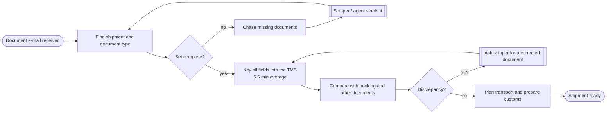
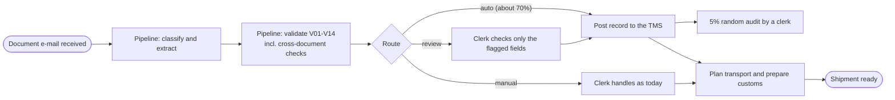

# Doc desk process: as-is and to-be

Mapped on the floor in week 2 with two clerks, then checked against the time study. The BPMN 2.0 files open in Camunda Modeler, bpmn.io or Signavio: [current-state.bpmn](current-state.bpmn), [future-state.bpmn](future-state.bpmn). Both are generated by [scripts/bpmn.py](../scripts/bpmn.py), so the diagrams stay in version control as text.

## As-is

**Where the time and the errors go**

| Step | Time (time study) | What goes wrong |
|---|---|---|
| Find shipment and document type | 0.8 min | Wrong shipment picked when references are missing |
| Key all fields | 3.9 min | 2.1% of documents get at least one keying error |
| Compare with booking and other documents | 0.8 min | Done from memory when busy; weight mismatches slip through |
| Chase and correct | not timed (waiting) | Shipments sit for hours or days |

The comparison step is where clerks add the most value and the step they skip first under pressure. That is why the pilot automates the comparison (cross-document rules) as much as the typing.

## To-be, with the pilot

**What changes for a clerk**

| Today | With the pilot |
|---|---|
| Opens every e-mail, keys every field | Sees a queue of documents that need a person, each with the reasons |
| Compares weights and counts from memory | Gets a flag when documents of one shipment disagree |
| Is accountable for everything keyed | Is accountable for the fields they were asked to check; the audit sample covers the rest |
| 5.5 minutes per document | About <!--n:bc.minutes_after-->1.1<!--/n--> minutes per document on average across all documents (straight-through documents only in the 5% audit) |

The routing rules, reasons and audit are specified in [human oversight](../07-governance/human-oversight.md); the measured split is in the [pilot results](../06-applied-ai/pilot-results.md).
