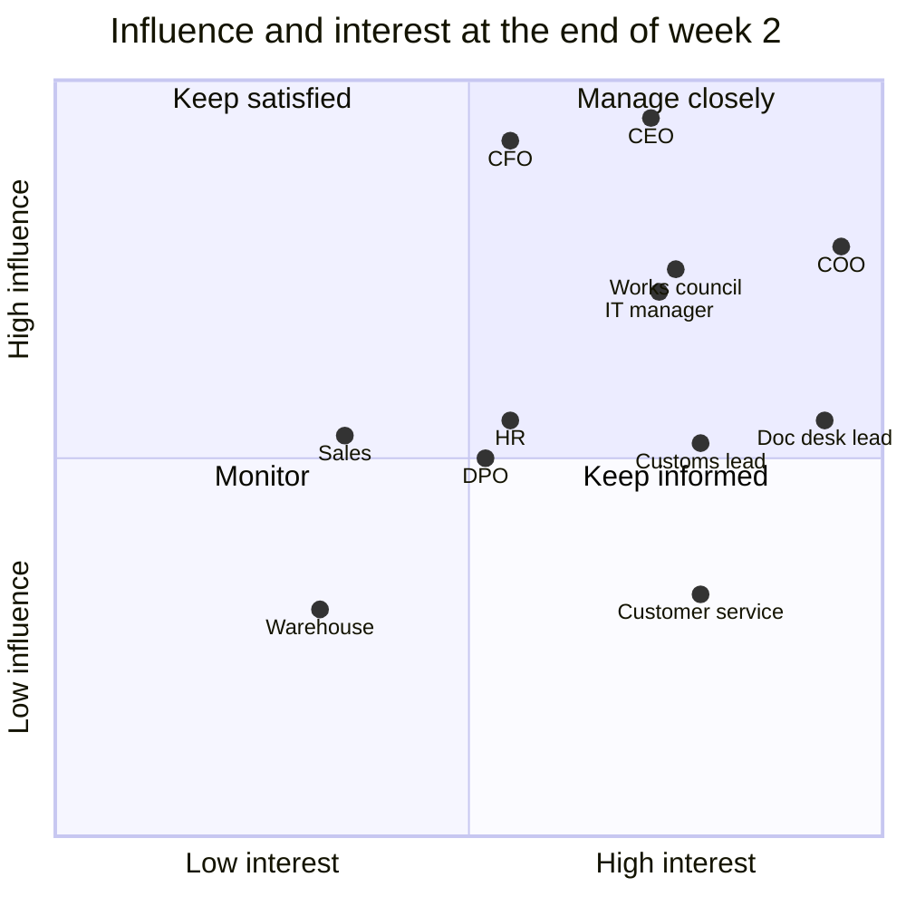

# Stakeholder map

Twelve stakeholders, interviewed in weeks 1-2. Influence and interest are scored 1-5 from the interviews; stance is how each one stood at the end of week 2, not where we wanted them to be.

<!--table:stakeholders-->
| Who | Role | Influence | Interest | Stance | Concern | What they need | How we engage |
|---|---|---|---|---|---|---|---|
| Ilse Vandamme | CEO, second-generation owner | 5 | 4 | supporter | Wants a plan the board believes; afraid of an expensive science project. | A decision in euros with the risks named. | Sponsor; steering every 4 weeks; presents at the board. |
| Koen De Clercq | CFO | 5 | 3 | sceptic | Has seen 'efficiency' that never reached the P&L. | Cash view separate from capacity view; monthly value tracking. | Owns the business case and KPI dashboard; signs off gates. |
| Nadia El Amrani | COO | 4 | 5 | champion | Cannot hire clerks fast enough; error costs show up in her budget. | Something that works on Monday morning, not a slide. | Owns UC-01; weekly pilot review. |
| Bart Lievens | Doc desk team lead | 3 | 5 | neutral | Team fears for jobs; worried about errors he will be blamed for. | A say in the review flow; a clear rule on who is accountable. | Product owner for UC-01; co-designed the review queue. |
| Sofie Verhaeghe | Customs lead | 3 | 4 | champion | Declarations are legally hers; AI must not create liability. | Declarant in the loop, audit trail. | Owner UC-03; AI champion. |
| Pieter Maes | IT manager | 4 | 4 | neutral | Six people, already full; the TMS vendor is slow. | A platform, not ten tools; support from the partner during build. | Owns integration and the orchestration layer. |
| Lotte Claeys | Customer service lead | 2 | 4 | supporter | E-mail volume grows faster than the team. | Drafts that sound like Wendelkaai, not like a robot. | Owner UC-02. |
| Hilde Peeters | HR manager and works council liaison | 3 | 3 | neutral | The 2023 telematics roll-out was announced too late. | Early information; a clear statement on jobs. | Owns literacy programme and works council track. |
| Joris Vermeulen | External DPO | 3 | 3 | neutral | Customer e-mails contain personal data; vendor terms. | Inventory, DPIA where needed, vendor data terms. | Owns AI inventory and DPIA. |
| Wim Desmet | Sales director | 3 | 2 | supporter | Competitors pitch 'AI' to his customers. | A story for customers; faster quotes. | Owner UC-10; informed monthly. |
| Ahmed Benali | Warehouse manager | 2 | 2 | neutral | Not in wave 1; wants forecasting later. | To know when it is his turn and what data to fix first. | Data owner for warehouse data; informed quarterly. |
| Works council | Employee representatives | 4 | 4 | sceptic | Jobs, monitoring of employees, being informed late. | Information before decisions; no individual monitoring. | Informed and consulted at weeks 1, 14 and 30; UC-08 parked. |
<!--/table-->

## What this changed in the plan

- **The CFO is the decision-maker to convince, not the CEO.** The CFO has seen efficiency programmes that never reached the P&L. That is why the [business case](../04-business-case/cost-benefit-analysis.md) separates a cash view from a capacity view, and why the CFO owns the KPI dashboard.
- **The works council is a high-influence stakeholder, not an afterthought.** The 2023 telematics roll-out was announced after the fact and still causes friction. The council was informed in week 1, before any pilot, and the performance-monitoring idea ([UC-08](../03-opportunity-discovery/use-case-catalog.md)) was parked openly.
- **The doc desk lead goes from neutral to product owner.** The team fears for jobs and for blame. Making the lead the product owner of the pilot, with the clerks co-designing the review queue, turned the biggest adoption risk into the pilot's main source of domain knowledge.
- **IT is capacity-constrained, not opposed.** Six people, a slow TMS vendor. The roadmap gives IT one platform (the [orchestration layer](../05-transformation-roadmap/operating-model.md)) instead of a tool per use case, and partner support in year 1.
