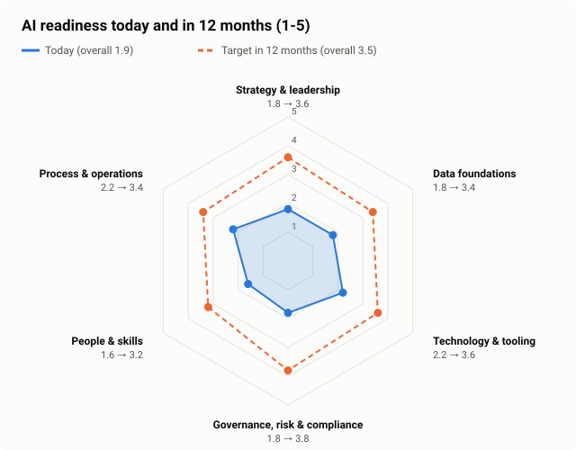

# AI readiness assessment

**Wendelkaai scores <!--n:rd.overall-->1.9<!--/n--> out of 5 overall: <!--n:rd.level-->Experimenting<!--/n-->.** The 12-month target is <!--n:rd.target-->3.5<!--/n-->. The lowest dimension is <!--n:rd.lowest-->People & skills (1.6)<!--/n-->. Interactive version: [site/readiness](../site/readiness/index.html). Workbook to re-score: [readiness-scorecard.xlsx](readiness-scorecard.xlsx).

<!--table:readiness-dimensions-->
| Dimension | Today | Level | Target (12 months) |
|---|---|---|---|
| Strategy & leadership | 1.8 | Experimenting | 3.6 |
| Data foundations | 1.8 | Experimenting | 3.4 |
| Technology & tooling | 2.2 | Experimenting | 3.6 |
| Governance, risk & compliance | 1.8 | Experimenting | 3.8 |
| People & skills | 1.6 | Experimenting | 3.2 |
| Process & operations | 2.2 | Experimenting | 3.4 |
| **Overall** | **1.9** | **Experimenting** | **3.5** |
<!--/table-->

## What the scores say

- **The company is ready to *use* AI before it is ready to *govern* it.** Documents are digital (D3 = 3), identity and cloud exist (T1 = 3), the ISMS is certified (T5 = 3). But there is no AI policy, no inventory and no owner (G1, G2, S3 = 1). That combination is why shadow AI is at 38%.
- **Data is good enough for documents, not for forecasting.** The pilot reads documents, so poor master data barely matters to it. Forecasting and route optimisation need owned, clean master data first (D1, D2), which is why they sit in later waves.
- **People are the lowest dimension and the biggest risk.** 61% of staff expect AI to take jobs at the desk; 22% feel confident using it. Literacy is a legal duty too: since 2 February 2025 Article 4 of the EU AI Act asks deployers to take measures for AI literacy; after the Digital Omnibus it is an obligation to take measures that support literacy, not to guarantee a level ([EU AI Act assessment](../07-governance/eu-ai-act-assessment.md)).
- **Process measurement was missing.** Nobody knew the handling time or the error rate before the time study. Without a baseline no AI project can prove value (S4, O2).

## All 30 items, with evidence

<!--table:readiness-items-->
| # | Question | Today | Target | Evidence |
|---|---|---|---|---|
| S1 | AI ambition is linked to named business goals | 2 | 4 | The board asked for 'an AI plan'; no goals or KPIs attached. The 2027 business plan names margin pressure and doc desk hiring problems, not AI. |
| S2 | An executive sponsor owns AI and has a budget | 2 | 4 | The CEO sponsors informally; no budget line. IT funds tool trials from its own budget. |
| S3 | AI initiatives are managed as one portfolio | 1 | 3 | Three unconnected experiments found (sales ChatGPT prompts, a customs Excel macro with an AI add-in, a warehouse vendor demo). Nobody had an overview. |
| S4 | Value is measured against a baseline | 2 | 4 | Doc desk volumes are counted per month; handling time and error rates were never measured before the discovery time study. |
| S5 | There is a view on partners and buy versus build | 2 | 3 | IT prefers the TMS vendor's roadmap; operations wants faster results. No criteria to decide. |
| D1 | Data domains have named owners | 1 | 3 | Customer and location master data are edited by whoever needs a change. No owner for document data. |
| D2 | Core master data is of usable quality | 2 | 3 | Sample of 200 customer records: 14% duplicates, 9% missing VAT or EORI. |
| D3 | Documents are available digitally | 3 | 4 | 90% of documents arrive as PDF by e-mail; the rest is scanned at the desk. Archive in the TMS document store, 7 years. |
| D4 | Labelled historical data exists to evaluate AI | 1 | 3 | None before the pilot. The pilot built the first labelled sets (2 x 220 documents). |
| D5 | Core systems can be reached through APIs | 2 | 4 | The TMS has an import API for bookings, undocumented for documents; the ERP only exports files overnight. |
| T1 | Cloud platform and identity are in place | 3 | 4 | Microsoft 365 and Entra ID for all staff; one Azure subscription used for backups. |
| T2 | Staff have sanctioned AI tools | 2 | 4 | No approved tool; the staff survey shows 38% use public chatbots for work, including with customer data. |
| T3 | An AI orchestration layer exists (model access, prompts, logging, evaluation) | 1 | 3 | None. Each experiment calls its own tool directly. |
| T4 | Systems are monitored in a way AI can plug into | 2 | 3 | Infrastructure monitoring exists; no application or business-level monitoring. |
| T5 | Security baseline is mature | 3 | 4 | ISO/IEC 27001 certified for IT services and customs data since 2024; supplier assessments are done, but not for AI services. |
| G1 | An AI policy says what is allowed | 1 | 4 | No AI policy. The acceptable-use policy predates generative AI. |
| G2 | AI systems are inventoried and classified (EU AI Act) | 1 | 4 | No inventory. The three experiments were found during interviews. |
| G3 | Human oversight and accountability are designed in | 2 | 4 | Four-eyes checks exist for customs declarations; no rules for AI output. |
| G4 | Privacy reviews (GDPR, DPIA) are routine | 3 | 4 | External DPO; DPIAs done for CCTV and telematics. Process exists, never applied to AI. |
| G5 | Vendor and model risk is managed | 2 | 3 | Supplier register exists; no criteria for data use, retention or model changes at AI vendors. |
| P1 | Staff understand what AI can and cannot do (AI literacy) | 1 | 3 | No training. Survey: 61% expect AI to 'replace jobs at the desk', 22% feel confident using it. |
| P2 | There are internal AI champions | 1 | 3 | Two enthusiasts (customs, sales) experimenting on their own time. |
| P3 | Product ownership exists for digital solutions | 2 | 3 | IT acts as order-taker; no business product owners. |
| P4 | Technical skills to run AI solutions are available | 2 | 3 | IT team of six: infrastructure and ERP support; one developer with Python and API experience. |
| P5 | The works council is involved early | 2 | 4 | Good relationship; informed about telematics after the fact in 2023, which still causes friction. |
| O1 | Core processes are documented | 2 | 3 | Work instructions per customer in Word files on a shared drive, 340 files, a third older than 3 years. |
| O2 | Process KPIs are measured | 2 | 4 | Volumes and on-time delivery measured; handling time, rework and error cost not. |
| O3 | Exceptions are handled in a defined way | 2 | 3 | Exceptions go to whoever is free; no categories, no log. |
| O4 | There is a change management practice | 2 | 3 | TMS go-live in 2014 remembered as painful; no change approach since. |
| O5 | Teams improve their own work | 3 | 4 | Monthly operations meeting with improvement actions; strong pragmatism on the floor. |
<!--/table-->

Scored by the consultant and the COO separately in week 2; reconciled in the readout with the leadership team. Next: [gap analysis](gap-analysis.md).
