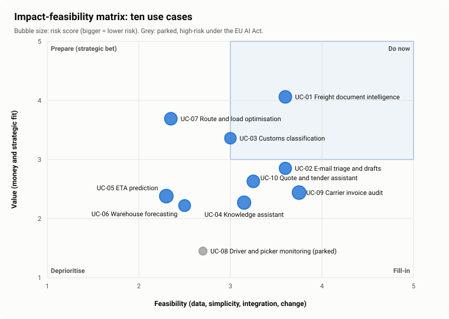

# Impact-feasibility matrix

*Value* combines annual value (70%) and strategic fit (30%). *Feasibility* combines data readiness, technical simplicity, integration ease and change ease. Bubble size is the risk score. Interactive version with weight sliders: [site/opportunities](../site/opportunities/index.html).

## How to read it

| Quadrant | Use cases | What it means for the roadmap |
|---|---|---|
| **Do now** (high value, feasible) | UC-01, UC-03 | UC-01 is the pilot. UC-03 is feasible on paper but has the lowest error tolerance in the portfolio (a wrong HS code means duties and audit findings), and it reuses UC-01's platform; it waits for wave 3. |
| **Prepare** (high value, hard) | UC-07 | Worth doing, not yet doable: location data must be cleaned and owned first. Wave 3 prepares a buy decision. |
| **Fill-in** (feasible, lower value) | UC-09, UC-02, UC-10, UC-04 | Cheap because they reuse what UC-01 builds (UC-09) or what a sanctioned assistant gives everyone (UC-04, UC-10). UC-02 is wave 2 once the DPIA is done. |
| **Deprioritise** | UC-05, UC-06 | Blocked by data foundations, not by AI. |
| **Parked** | UC-08 | High-risk under the EU AI Act; no owner; works council. |

## What the matrix does not show

- **Dependencies.** UC-09 and UC-03 reuse the document pipeline; they are cheap *after* UC-01, expensive before it.
- **Readiness.** A feasible use case can still be blocked by a governance gap (no policy, no inventory). The [gap analysis](../02-ai-readiness/gap-analysis.md) adds that layer.
- **Uncertainty in the scores.** The [prioritization](prioritization.md) tests how robust the ranking is when the weights move.
