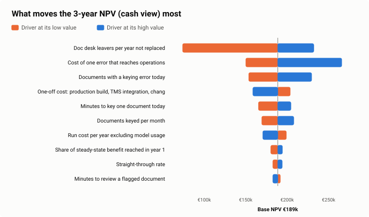

# Business case: UC-01 freight document intelligence

**Decision asked:** invest <!--n:bc.one_off-->€85k<!--/n--> one-off and about <!--n:bc.run_cost_y1-->€20k<!--/n--> a year to take the pilot to production for all five document types.

**Answer in one line:** on the cash view it pays back in <!--n:bc.cash.payback-->15 months<!--/n--> with a 3-year NPV of <!--n:bc.cash.npv-->€189k<!--/n-->. The result depends more on a people decision (whether leavers are replaced) and on what an error really costs than on how accurate the model is.

Model: [engine/business_case.py](../engine/business_case.py) · Assumptions: [assumptions.md](assumptions.md) · Workbook: [roi-calculator.xlsx](roi-calculator.xlsx) · Interactive: [site/business-case](../site/business-case/index.html)

## Two views, because freed hours are not saved euros

| | Capacity view | Cash view |
|---|---|---|
| What counts | Every freed clerk hour at its loaded cost | Only cost that leaves the books: hires avoided as volume grows, plus leavers not replaced (every second one, agreed with HR and the works council), capped at the hours actually freed |
| 3-year NPV (8%) | <!--n:bc.capacity.npv-->€232k<!--/n--> | **<!--n:bc.cash.npv-->€189k<!--/n-->** |
| Payback | <!--n:bc.capacity.payback-->13 months<!--/n--> | **<!--n:bc.cash.payback-->15 months<!--/n-->** |
| 3-year ROI | <!--n:bc.capacity.roi-->342%<!--/n--> | <!--n:bc.cash.roi-->284%<!--/n--> |

The board decides on the cash view. The capacity view shows the room the doc desk gets for work it has no time for today: customs files, exceptions, customer questions.

## Where the value comes from

1. **Time.** A document takes 5.5 minutes to key today. With the pilot's measured routing (<!--n:pilot.stp-->70.0%<!--/n--> straight-through, <!--n:pilot.review-->25.4%<!--/n--> reviewed, <!--n:pilot.manual-->4.5%<!--/n--> by hand) the average drops to <!--n:bc.minutes_after-->1.1<!--/n--> minutes, saving <!--n:bc.saved_minutes-->4.4<!--/n--> minutes per document: <!--n:bc.hours_y2-->3,664<!--/n--> hours in year 2, or <!--n:bc.fte_y2-->2.4<!--/n--> FTE of an 11-person team.
2. **Errors.** Today 2.1% of documents carry a keying error. With the pilot the expected rate is <!--n:bc.error_rate_after-->0.71%<!--/n--> (unflagged pilot errors, plus fewer errors on reviewed documents, plus documents still keyed by hand). That avoids <!--n:bc.errors_avoided_y2-->696<!--/n--> errors in year 2, worth <!--n:bc.error_value_y2-->€42k<!--/n--> at €60 each.
3. **Cost.** Model usage is small: about <!--n:bc.model_cost_doc-->€0.020<!--/n--> per document, <!--n:bc.model_cost_y1-->€950<!--/n--> in year 1. Hosting, monitoring and upkeep dominate the run cost.

## Three years

<!--table:bc-years-->
|  | Year 1 | Year 2 | Year 3 |
|---|---|---|---|
| Documents | 48,000 | 49,920 | 51,917 |
| Clerk hours freed | 2,114 | 3,664 | 3,810 |
| FTE freed | 1.38 | 2.39 | 2.49 |
| FTE that leave the cost base (cash view) | 0.94 | 1.90 | 2.49 |
| Errors avoided | 402 | 696 | 724 |
| Capacity value | €71,865 | €124,566 | €129,549 |
| Cash labour value | €48,880 | €98,675 | €129,499 |
| Error cost avoided | €24,090 | €41,757 | €43,427 |
| Model usage | -€950 | -€988 | -€1,028 |
| Run cost incl. model usage | -€19,950 | -€19,988 | -€20,028 |
| **Net, capacity view** | **€76,005** | **€146,335** | **€152,948** |
| **Net, cash view** | **€53,020** | **€120,444** | **€152,898** |
<!--/table-->

Year 1 reaches 60% of the steady-state benefit: go-live is in week 12 and document types are switched on one by one.

## Scenarios

<!--table:bc-scenarios-->
| Scenario | NPV cash view | Payback cash view | NPV capacity view | Payback capacity view |
|---|---|---|---|---|
| Pessimistic | -€142k | not within 3 years | -€68k | not within 3 years |
| Base | €189k | 15 months | €232k | 13 months |
| Optimistic | €576k | 5 months | €655k | 4 months |
| Base, but every leaver replaced | €74k | 22 months | – | – |
<!--/table-->

**The pessimistic case loses money, and the board should know.** It puts every driver on its bad side at once: fewer documents, faster manual keying, slower reviews, the bottom of the pilot's confidence interval, cheap errors, a 115k build, slow ramp-up and no leavers left unreplaced. That combination is unlikely, but it tells the board which levers to watch: they are in the tornado below.

**If every leaver is replaced after all**, the cash case still pays back (NPV <!--n:bc.noattr_npv-->€74k<!--/n-->, payback <!--n:bc.noattr_payback-->22 months<!--/n-->), carried by growth that no longer needs new hires and by avoided errors.

## What moves the result

<!--table:tornado-->
| Driver | NPV at low value | NPV at high value | Swing |
|---|---|---|---|
| Doc desk leavers per year not replaced | €74k | €232k | €158k |
| Cost of one error that reaches operations | €150k | €266k | €116k |
| Documents with a keying error today | €154k | €230k | €76k |
| One-off cost: production build, TMS integration, change and training | €204k | €159k | €45k |
| Minutes to key one document today | €165k | €205k | €39k |
| Documents keyed per month | €169k | €208k | €39k |
| Run cost per year excluding model usage | €199k | €171k | €28k |
| Share of steady-state benefit reached in year 1 | €180k | €194k | €14k |
| Straight-through rate | €183k | €194k | €11k |
| Minutes to review a flagged document | €192k | €183k | €9k |
<!--/table-->

**The biggest lever is not the AI.** The top driver is <!--n:bc.tornado_top-->Doc desk leavers per year not replaced<!--/n--> (swing <!--n:bc.top_swing-->€158k<!--/n-->), then <!--n:bc.tornado_top2-->Cost of one error that reaches operations<!--/n-->. The straight-through rate, the number most AI pilots obsess over, swings the NPV by only <!--n:bc.stp_swing-->€11k<!--/n--> across its confidence interval: documents that are not straight-through still arrive pre-filled and checked, so they take minutes, not the full keying time.

That shifts the management agenda:
- **Make the people decision explicit.** The cash only shows up if the company decides what freed capacity is for. HR, the works council and the COO agreed: no redundancies, every second leaver not replaced while the solution scales, and capacity redirected to customs files.
- **Measure the cost of an error.** It is an estimate today (€35-110). The KPI dashboard (R06) tracks customs amendments and demurrage linked to document errors from week 2, so the estimate becomes a measurement within a quarter.
- **Do not chase the last percent of straight-through.** Better to keep the error budget tight and the review fast.

## What is not in the numbers

- **The pilot cost (€38k) is sunk** and not in the NPV.
- **Soft benefits are excluded:** faster shipment release, fewer customer complaints, being able to answer the pharma customers' AI governance questions, clerks doing more interesting work.
- **Scale effects are excluded:** UC-09 and UC-03 reuse the platform. Their business cases carry their own costs, but not the platform's.
- **Model price changes:** prices have fallen every year; the case assumes today's list price for the whole period.

## Kill criteria (agreed with the CFO)

| When | Stop or rethink if |
|---|---|
| G2, week 13 | Straight-through below 60% or escape rate above 1% in shadow mode on real documents |
| G3, week 26 | Value realised below 50% of the plan for the quarter, without a known cause |
| Any time | Escape rate above 2% for two weeks in the audit sample |
