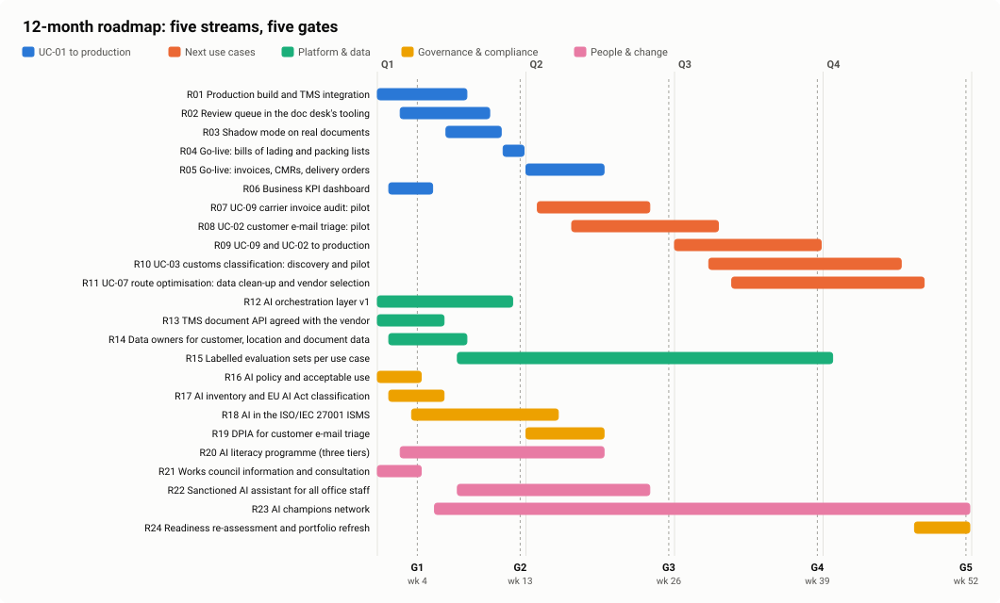

# 12-month roadmap

Five streams, five gates, one platform. Week 1 is the first week after the board decision. Data: [model/roadmap.json](../model/roadmap.json); interactive version: [site/roadmap](../site/roadmap/index.html).

## Waves

<!--table:waves-->
| Wave | Use cases |
|---|---|
| Wave 1 (weeks 1-20) | UC-01 Freight document intelligence |
| Wave 2 (weeks 15-39) | UC-09 Carrier invoice audit, UC-02 Customer e-mail triage and draft replies |
| Wave 3 (weeks 30-52) | UC-03 Customs classification assistant, UC-07 Route and load optimisation |
| Covered by the sanctioned assistant | UC-04 Internal knowledge assistant, UC-10 Quote and tender assistant |
| After data foundations | UC-05 ETA prediction and delay alerts, UC-06 Warehouse volume forecasting for staffing |
| Parked | UC-08 Driver and warehouse performance monitoring |
<!--/table-->

## Gates

Each gate is a decision meeting (steering: CEO, CFO, COO, IT manager, partner lead), not a status update. Passing a gate releases the budget for the next stage.

<!--table:gates-->
| Gate | Week | Name | Pass criteria |
|---|---|---|---|
| G1 | 4 | Build ready | Integration design signed by IT and the TMS vendor; KPI dashboard live with the pre-AI baseline; AI policy approved |
| G2 | 13 | First go-live | Shadow mode on real documents: straight-through rate at least 60%; Error escape rate at most 1% on the audited sample; Clerks trained; review queue in daily use |
| G3 | 26 | UC-01 complete, wave 2 decision | All five document types live; Value realised tracked monthly against the business case; UC-09 pilot measured; UC-02 go/no-go |
| G4 | 39 | Wave 2 live | UC-09 and UC-02 in production; Business cases for UC-03 and UC-07 reviewed |
| G5 | 52 | Annual review | Readiness re-assessed; Portfolio refreshed; Year-2 budget proposed |
<!--/table-->

## All items

<!--table:roadmap-items-->
| # | Stream | What | Weeks | Owner | Deliverable |
|---|---|---|---|---|---|
| R01 | UC-01 to production | Production build and TMS integration | 1–8 | IT manager | Pipeline posting to the TMS import API, with retries and an audit log |
| R02 | UC-01 to production | Review queue in the doc desk's tooling | 3–10 | Doc desk team lead | Queue that shows flagged fields, reasons and the source document side by side |
| R03 | UC-01 to production | Shadow mode on real documents | 7–11 | Doc desk team lead | Pipeline runs next to the clerks; differences labelled; first real evaluation set |
| R04 | UC-01 to production | Go-live: bills of lading and packing lists | 12–13 | COO | Two document types straight-through within the error budget |
| R05 | UC-01 to production | Go-live: invoices, CMRs, delivery orders | 14–20 | COO | All five document types live |
| R06 | UC-01 to production | Business KPI dashboard | 2–5 | CFO | Straight-through rate, escapes from the audit sample, review time, value realised |
| R07 | Next use cases | UC-09 carrier invoice audit: pilot | 15–24 | CFO | Reuses the document pipeline; measured on 3 months of carrier invoices |
| R08 | Next use cases | UC-02 customer e-mail triage: pilot | 18–30 | Customer service lead | Drafts for status questions, agent sends; measured on handling time and quality |
| R09 | Next use cases | UC-09 and UC-02 to production | 27–39 | COO | Both live, monitored on the same platform |
| R10 | Next use cases | UC-03 customs classification: discovery and pilot | 30–46 | Customs lead | Pilot on 300 past classifications, declarant in the loop |
| R11 | Next use cases | UC-07 route optimisation: data clean-up and vendor selection | 32–48 | Transport manager | Clean location data; buy decision between 3 planning tools |
| R12 | Platform & data | AI orchestration layer v1 | 1–12 | IT manager | Model gateway, prompt registry, logging, evaluation harness, cost tracking |
| R13 | Platform & data | TMS document API agreed with the vendor | 1–6 | IT manager | Documented endpoint for document records; file-drop fallback |
| R14 | Platform & data | Data owners for customer, location and document data | 2–8 | COO | Named owners, change process, monthly quality report |
| R15 | Platform & data | Labelled evaluation sets per use case | 8–40 | Doc desk team lead | Real documents, labelled during review, refreshed quarterly |
| R16 | Governance & compliance | AI policy and acceptable use | 1–4 | CEO | One-page policy, approved tools list, rules for customer data |
| R17 | Governance & compliance | AI inventory and EU AI Act classification | 2–6 | DPO | Register of AI systems with risk tier, owner and review date; quarterly refresh |
| R18 | Governance & compliance | AI in the ISO/IEC 27001 ISMS | 4–16 | IT manager | AI suppliers assessed, risk register and Statement of Applicability updated |
| R19 | Governance & compliance | DPIA for customer e-mail triage | 14–20 | DPO | DPIA signed before the UC-02 pilot touches real e-mails |
| R20 | People & change | AI literacy programme (three tiers) | 3–20 | HR | All staff 90 minutes; users half a day; builders two days |
| R21 | People & change | Works council information and consultation | 1–4 | HR | Plan presented before go-live; agreement on no redundancies and attrition |
| R22 | People & change | Sanctioned AI assistant for all office staff | 8–24 | IT manager | One approved assistant inside Microsoft 365; covers drafting and knowledge needs (UC-04, UC-10) without custom builds |
| R23 | People & change | AI champions network | 6–52 | COO | Eight champions, two hours a week, monthly show-and-tell |
| R24 | Governance & compliance | Readiness re-assessment and portfolio refresh | 48–52 | CEO | Updated scorecard, ranked portfolio, year-2 plan |
<!--/table-->

## Why this order

1. **Governance starts in week 1, not after the pilot.** The AI policy, the inventory and the works-council information are cheap, fast and unblock everything else (gap analysis: G1, G2, P5).
2. **One platform before many use cases.** The orchestration layer (R12) is built with UC-01, so UC-09 and UC-02 cost a fraction: same gateway, same logging, same evaluation harness, same review queue pattern.
3. **Shadow mode before go-live.** The pilot was measured on synthetic documents. Weeks 7-11 run it next to the clerks on real ones, and gate G2 is measured there, not on the pilot sets.
4. **The general assistant covers the long tail.** Drafting and knowledge questions (UC-04, UC-10) are served by one sanctioned assistant for all office staff (R22) rather than custom builds; usage data decides whether a custom build is ever needed.
5. **Data foundations before prediction.** Forecasting and route optimisation wait for data owners and clean location data.

## Budget envelope (year 1, indicative)

| Block | Estimate | Note |
|---|---|---|
| UC-01 production build, integration, change | <!--n:bc.one_off-->€85k<!--/n--> | Business case A15 |
| UC-01 run cost | <!--n:bc.run_cost_y1-->€20k<!--/n--> | Business case A16 plus model usage |
| Wave 2 pilots (UC-09, UC-02) | €60-80k | Reuse the platform; separate business cases at G3 |
| Wave 3 discovery (UC-03, UC-07) | €30-40k | Discovery and vendor selection only |
| Literacy programme and champions | €15-20k | External trainers for tier 1 and 2; champions' time is internal |
| Sanctioned assistant licences | per seat | Decision in R22, depends on seat count and vendor |

Only UC-01 is asked from the board now. Wave 2 and 3 come back as separate decisions at G3 and G4, each with its own business case.
