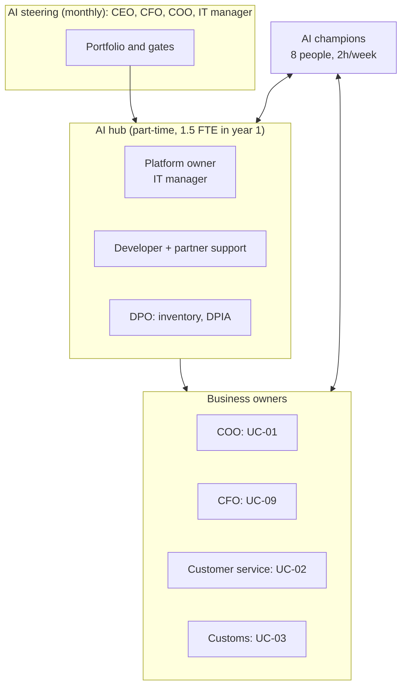
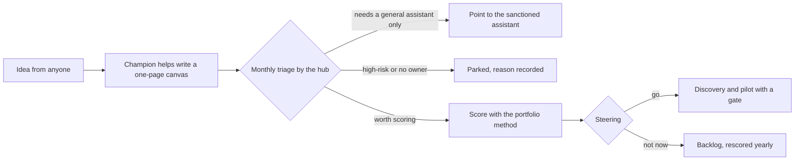

# Operating model

How Wendelkaai runs AI after the consultants leave: who decides, who builds, which platform, and how a new idea becomes a use case or a "no".

## Shape: a small hub, owners in the business

| Role | Who | Time | What they do |
|---|---|---|---|
| AI steering | CEO (chair), CFO, COO, IT manager | 1 hour a month | Portfolio, gates, budget, risks |
| Platform owner | IT manager | 20% | Orchestration layer, vendors, security, changes to models and prompts |
| Developer | Internal developer + partner (year 1) | 60% + partner days | Builds and maintains pipelines on the platform |
| Use-case owner | A business manager per use case | Varies | Value, adoption, error budget, the people side |
| Product owner | Team lead per use case (e.g. doc desk lead) | 20% during build | Day-to-day decisions, review flow, acceptance |
| DPO | External DPO | On call | AI inventory, classification, DPIAs |
| AI champions | Eight volunteers across teams | 2 hours a week | First-line help, ideas, feedback, show-and-tell |

## The AI orchestration layer

One platform for every use case, built with UC-01 (roadmap R12). It is what keeps use case number five as cheap and as governed as number one.

| Component | What it does | In the pilot |
|---|---|---|
| Model gateway | Single way to call models; provider and model version pinned per use case; fallbacks | `freightdoc/providers/` with an offline provider and a Claude provider behind one interface |
| Prompt registry | Prompts in version control, reviewed like code | [`prompts/extract.md`](../06-applied-ai/prototype/prompts/extract.md) |
| Evaluation harness | Golden sets, metrics, release gate that must pass before any change | [`evals/run.py`](../06-applied-ai/prototype/evals/run.py) with [`thresholds.json`](../06-applied-ai/prototype/evals/thresholds.json) |
| Validation and routing | Business rules and human-in-the-loop routing as configuration | `validate.py`, `pipeline.Policy` |
| Logging and audit | Every input, output, route, reviewer decision, model version | Production build (R01, R12) |
| Monitoring | Straight-through rate, escape rate from the audit, review time, cost per document | KPI dashboard (R06) |
| Cost tracking | Tokens and euros per document and per use case | Production build |

## From idea to use case

The canvas template is in the [playbook](../09-playbook/templates/use-case-canvas.md); the scoring method is [the one used here](../03-opportunity-discovery/prioritization.md).

## Year 2

Re-assess readiness at week 48 (R24). If two or more use cases are live and the platform is stable, move from partner support to a fully internal hub, and consider ISO/IEC 42001 certification if customers start asking for it.
