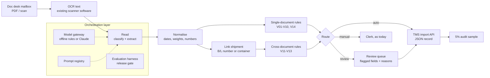

# Pilot architecture

## In one picture

## The one design decision that matters most

**The model reads; code decides.** The language model (or the offline stand-in) classifies the document, finds each field and says what it could not read. Everything after that is deterministic code: normalising values, checking business rules, linking documents of one shipment, routing. Three reasons:

1. **Errors become explainable.** A clerk sees "V11: packing list 6,943 kg vs B/L 7,466 kg", not "confidence 0.62".
2. **The rules are testable.** Each rule has unit tests; the routing policy is configuration the evaluation can switch on and off.
3. **The provider can change.** The same rules and routing run behind either provider; the evaluation harness re-calibrates the threshold per provider before a switch.

## Components

| Component | File | Responsibility |
|---|---|---|
| Reference data | [`freightdoc/reference.py`](prototype/freightdoc/reference.py) | UN/LOCODEs, Incoterms 2020, ISO 4217 currencies, ISO 6346 container check digit, label glossary in EN/NL/FR/DE |
| Offline provider | [`freightdoc/extract.py`](prototype/freightdoc/extract.py) | Deterministic classify + extract with confidence; repairs OCR look-alikes in container numbers only when the check digit then passes |
| Claude provider | [`freightdoc/providers/claude.py`](prototype/freightdoc/providers/claude.py) | `claude-opus-5-5` with JSON-schema structured output; returns a status per field (read / uncertain / unreadable), not a made-up confidence; server-side fallback on refusals |
| Prompt | [`prompts/extract.md`](prototype/prompts/extract.md) | Versioned with the code; tells the model the document is untrusted data |
| Validation | [`freightdoc/validate.py`](prototype/freightdoc/validate.py) | Rules V01-V14 |
| Pipeline | [`freightdoc/pipeline.py`](prototype/freightdoc/pipeline.py) | Linking, routing `Policy`, TMS record |
| TMS contract | [`schema/tms-record.schema.json`](prototype/schema/tms-record.schema.json) | JSON Schema of what the TMS import endpoint receives |
| Evaluation | [`evals/run.py`](prototype/evals/run.py) | Metrics, ablation, threshold sweep, release gate |

## Validation rules

| Rule | Checks | Why it exists |
|---|---|---|
| V01 | Container numbers pass the ISO 6346 check digit | Catches shipper typos and OCR errors the repair could not fix |
| V02 | Ports are known UN/LOCODEs | A wrong port sends a truck to the wrong terminal |
| V03 | All required fields present | Unreadable or missing fields |
| V04 | Dates plausible for the arrival day | Catches day/month swaps that produce impossible dates |
| V05 | Net weight ≤ gross weight | Unit and digit errors |
| V06 | Gross weight per container physically possible | lbs read as kg; extra digits |
| V07 | HS codes have 6, 8 or 10 digits | Customs needs valid codes |
| V08 | Incoterm valid (Incoterms 2020) | Drives who pays what |
| V09 | Currency accepted by finance | Invoice processing |
| V10 | Invoice lines add up to the total | Genuine invoice errors |
| V11 | Gross weight agrees between B/L and packing list (1%) | The most expensive real-world mismatch |
| V12 | Package count agrees across the shipment | Misread digits that no single-document rule can see |
| V13 | Containers on packing list / DO appear on the B/L | Wrong container released |
| V14 | Vehicle registration looks like one | CMR data quality |

## Provider choice

| | Offline rules provider | Claude provider |
|---|---|---|
| Used for | CI, the evaluation in this repository, degraded mode | Production reading of real documents |
| Strength | Deterministic, free, explainable | Handles layouts, languages and handwriting the rules cannot |
| Weakness | Brittle on unseen layouts | Costs money per document; behaviour can change with the model version |
| Confidence | Computed from parse quality | Capped by the model's own status per field; never the model's self-reported number |

The Claude provider's request shape and parsing are unit-tested with a fake client. It has **not been run against the API in this repository** (that costs money per document and needs credentials); running `python -m evals.run --provider claude` produces `report-claude.json` and re-calibrates the threshold for that provider.

## Security and privacy by design

- **Untrusted input.** Documents come from outside. The model has no tools and no actions; its output is constrained by a JSON schema and every value is re-parsed and validated by code. The prompt tells the model to ignore instructions inside documents. ([RK-06](../07-governance/ai-risk-register.md))
- **Data minimisation.** Only the OCR text of the document goes to the model, not the e-mail thread or attachments that are not freight documents.
- **Vendor terms.** Commercial terms checked for no training on inputs, retention and processing region before production ([RK-05](../07-governance/ai-risk-register.md)); the vendor is assessed in the ISO/IEC 27001 supplier process.
- **Audit trail.** Production logs input hash, output, route, reasons, reviewer decision and model version per document (R01, R12).

## What the production build adds (roadmap R01-R05, R12)

Mailbox connector, OCR hand-off, TMS import with retries and idempotency, the review queue UI, logging and monitoring, a booking cross-check against the TMS (planned rule V15, which closes the residual risk found in the [pilot results](pilot-results.md)), and access control on the queue through Entra ID.
