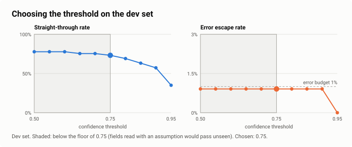

# Evaluation framework

The question the evaluation answers is not "how accurate is the model?" but **"how many wrong documents reach the TMS without anyone being asked to look, and how much work do we save while keeping that number inside the budget?"**

## Data

| Set | Documents | Used for | Rule |
|---|---|---|---|
| dev | 220 | Ablation, threshold selection, debugging | Look at it as much as you like |
| test | 220 | Reported results and the release gate | Same recipe, different seed; never used to tune anything |

Both sets come from [`scripts/make_data.py`](prototype/scripts/make_data.py): 40 shipments (B/L + invoice + packing list), 30 delivery orders, 60 CMRs and 10 non-freight documents, in English, Dutch, French and German, with faults injected at the rates measured in the [mailbox sample](../01-discovery/interview-synthesis.md). `truth.json` holds what a careful clerk would key and the genuine exceptions a person must handle. The provider never sees it (a unit test checks that).

## Metrics

| Metric | Definition | Why it matters |
|---|---|---|
| **Error escape rate** | Documents routed straight through that have a wrong or missing field, the wrong type, or a genuine exception, divided by all documents | The number the business agreed to cap. Comparable with today's keying error rate (2.1%) |
| **Straight-through rate** | Documents posted with no person involved | Drives the time saving |
| **Exception catch rate** | Documents with a genuine problem (weight mismatch, wrong check digit, missing seal, invoice that does not add up) that reached a person | A pipeline that never flags anything has a great straight-through rate |
| Review usefulness | Reviews where the document really had a problem | Too many useless flags and clerks stop looking (automation bias) |
| Classification accuracy, field accuracy, coverage | Standard extraction metrics | Diagnostics, not the decision |
| 95% confidence intervals | Wilson intervals on the rates | 220 documents is a small sample; the interval says how small |

## Ablation: what each layer buys

Four routing policies, from naive to full ([`pipeline.POLICIES`](prototype/freightdoc/pipeline.py)):

| | Policy | Sends to a person when |
|---|---|---|
| A | Extraction only | Never (except non-freight documents) |
| B | + confidence threshold | A field's confidence is below the threshold |
| C | + single-document rules | ... or a rule V01-V10/V14 fails |
| D | + cross-document rules | ... or V11-V13 fails |

The ablation is the argument for the design: it shows the board what "just use AI to read documents" would have done.

## Choosing the threshold

1. Sweep the confidence threshold from 0.50 to 0.95 on **dev** with policy D.
2. Keep thresholds where the escape rate is within the error budget (<!--n:pilot.error_budget-->1%<!--/n-->).
3. Never go at or below the confidence of fields read with an assumption (no unit = 0.60, ambiguous date = 0.70). This is the "no silent guessing" rule from [workshop 3](../01-discovery/workshop-series.md): floor <!--n:pilot.threshold_floor-->0.75<!--/n-->.
4. Among what is left, take the highest straight-through rate; on a tie, the higher threshold.
5. Run **test** once with that threshold. The gate checks that the threshold configured in the pipeline is the one the sweep picked, so nobody can hand-tune it.

## Release gate

[`evals/thresholds.json`](prototype/evals/thresholds.json), checked by `python -m evals.run --gate` in CI and before any change to prompts, models, rules or thresholds:

| Check | Target | Source |
|---|---|---|
| Classification accuracy | ≥ 97% | Engineering |
| Error escape rate | ≤ 1% | Workshop 3 (COO) |
| Error escape rate below today's human keying error rate | < 2.1% | Discovery double-check of 480 documents |
| Straight-through rate | ≥ 50% | Workshop 3: below this, review work eats the benefit |
| Exception catch rate | ≥ 95% | Workshop 3 |
| Configured threshold = threshold chosen on dev | equal | Prevents hand-tuning on test |

## From pilot evaluation to production monitoring

| Pilot (synthetic, labelled) | Shadow mode (weeks 7-11) | Production |
|---|---|---|
| Escape rate against truth files | Pipeline output compared with what clerks keyed | 5% random audit of straight-through documents, plus every reviewer correction |
| Gate on test set | Gate G2 on real documents | Weekly escape rate from the audit; alert above 1%; stop rule above 2% for two weeks |
| Labelled sets of 220 | First real labelled set | Labels grow as a by-product of review; quarterly refresh of the golden set (R15) |

The audit sample is small: 5% of about 2,800 straight-through documents a month is 140 documents, enough to see an escape rate of 1% move to 3%, not to measure 0.5% precisely. The KPI dashboard shows the interval, not just the point.
