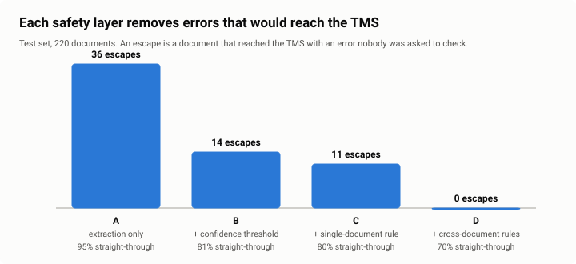

# Pilot results

*All numbers below are generated from the [evaluation report](prototype/evals/report.md) by `scripts/build.py`. Offline provider, synthetic documents.*

## Release gate (test set, <!--n:pilot.docs-->220<!--/n--> documents)

<!--table:pilot-gate-->
| Check | Result | Target |  |
|---|---|---|---|
| classification accuracy | 100.0% | >= 97.0% | pass |
| error escape rate | 0.0% | <= 1.0% | pass |
| error escape rate below human keying error rate | 0.0% | < 2.1% | pass |
| straight-through rate | 70.0% | >= 50.0% | pass |
| exception catch rate | 100.0% | >= 95.0% | pass |
| configured threshold = threshold picked on dev | 0.75 | == 0.75 | pass |
<!--/table-->

**Straight-through:** <!--n:pilot.stp-->70.0%<!--/n--> (95% CI <!--n:pilot.stp_ci_low-->63.6%<!--/n-->–<!--n:pilot.stp_ci_high-->75.7%<!--/n-->) · **Review:** <!--n:pilot.review-->25.4%<!--/n--> · **Manual:** <!--n:pilot.manual-->4.5%<!--/n--> · **Escapes:** <!--n:pilot.escapes-->0<!--/n--> (upper 95% bound <!--n:pilot.escape_ci_high-->1.7%<!--/n-->) · **Genuine problems caught:** <!--n:pilot.exceptions_caught-->100%<!--/n--> of <!--n:pilot.exception_docs-->12<!--/n--> · **Reviews that found a real problem:** <!--n:pilot.review_useful-->64%<!--/n-->

## What each layer buys

<!--table:pilot-ablation-->
| Configuration | Straight-through | Error escapes | Escape rate | Review |
|---|---|---|---|---|
| A: extraction only | 95.5% | 36 | 16.4% | 0.0% |
| B: + confidence threshold | 80.9% | 14 | 6.4% | 14.5% |
| C: + single-document rules | 79.5% | 11 | 5.0% | 15.9% |
| D: + cross-document rules | 70.0% | 0 | 0.0% | 25.4% |
<!--/table-->

Reading the documents is the easy part: extraction alone gets <!--n:pilot.A.stp-->95.5%<!--/n--> through, and <!--n:pilot.A.escapes-->36<!--/n--> of them are wrong. A confidence threshold alone still lets <!--n:pilot.B.escapes-->14<!--/n--> through, because many errors are read with full confidence: a digit misread by the scanner looks perfectly normal. Single-document rules catch broken check digits and impossible weights. Only the **cross-document rules** catch a weight that disagrees with the B/L or a package count that differs between documents, and that is where most of the remaining errors were.

## Threshold

<!--table:pilot-sweep-->
| Threshold | Straight-through | Escape rate | Review |
|---|---|---|---|
| 0.50 | 77.7% | 0.9% | 17.7% |
| 0.55 | 77.7% | 0.9% | 17.7% |
| 0.60 | 77.7% | 0.9% | 17.7% |
| 0.65 | 75.4% | 0.9% | 20.0% |
| 0.70 | 75.4% | 0.9% | 20.0% |
| 0.75 ← chosen | 73.2% | 0.9% | 22.3% |
| 0.80 | 69.1% | 0.9% | 26.4% |
| 0.85 | 63.2% | 0.9% | 32.3% |
| 0.90 | 57.3% | 0.9% | 38.2% |
| 0.95 | 35.0% | 0.0% | 60.5% |
<!--/table-->

On dev, the escape rate stays flat from 0.50 to 0.90 and only the review load changes; the business rules, not the threshold, are doing the safety work there. The threshold sits at the floor of <!--n:pilot.threshold-->0.75<!--/n--> because of the "no silent guessing" rule: below it, weights without a unit and ambiguous dates would pass unseen. They happen to be harmless in this sample, but in production a US shipper's weight in pounds without a unit is a real error.

## Where the faults went (test set)

<!--table:pilot-faults-->
| Fault injected | Documents | Went straight through | Reached the TMS wrong |
|---|---|---|---|
| illegible | 18 | 0 | 0 |
| label_ocr | 26 | 20 | 0 |
| missing_seal | 2 | 0 | 0 |
| no_unit | 10 | 0 | 0 |
| ocr_container | 12 | 7 | 0 |
| silent_digit | 6 | 0 | 0 |
| source_typo | 2 | 0 | 0 |
| sum_mismatch | 2 | 0 | 0 |
| weight_mismatch | 6 | 0 | 0 |
<!--/table-->

Faults that went straight through without an error are faults the pipeline fixed correctly: an OCR look-alike in a container number that the check digit could resolve, a garbled label it still recognised.

## Three evaluation runs that shaped the design

The pipeline did not pass the first time. The history is part of the result:

| Run | Change | Test result | What it taught |
|---|---|---|---|
| 1 | Shipments linked by B/L reference only | 36.4% straight-through, 3 escapes, 75% of genuine problems caught: **gate failed** | 30-40% of packing lists carry no B/L reference, so weight mismatches on them were never compared. The sweep then pushed the threshold to 0.95 to compensate, which killed straight-through. |
| 2 | Also link by container number | 73.6% straight-through, 1 escape, 91.7% caught: **gate failed** | The one escape was a compound fault: the B/L had a mistyped container number, so the packing list could not find its B/L. |
| 3 | Match containers on the first 10 characters (ignore the check digit when linking); add the 0.75 floor from workshop 3 | <!--n:pilot.stp-->70.0%<!--/n--> straight-through, <!--n:pilot.escapes-->0<!--/n--> escapes, <!--n:pilot.exceptions_caught-->100%<!--/n--> caught: **gate passed** | Linking is a business-logic problem, not a model problem. |

## Residual risk: what still gets through

On the **dev** set, <!--n:pilot.dev_escapes-->2<!--/n--> documents escaped: both CMRs with a digit misread by the scanner (21 packages read as 27; 1,901.5 kg read as 1,907.5 kg). A CMR stands alone: no other document to compare with, no checksum, and the misread value looks normal. Across both sets that is <!--n:pilot.pooled_escapes-->2<!--/n--> escapes in <!--n:pilot.pooled_docs-->440<!--/n--> documents (<!--n:pilot.pooled_escape_rate-->0.45%<!--/n-->, upper 95% bound <!--n:pilot.pooled_ci_high-->1.6%<!--/n-->); the business case uses the pooled rate, with the upper bound in the pessimistic scenario.

**Mitigation, in the production build:**
1. **V15: compare with the booking.** The TMS already holds the booked package count and weight for most road transports. A CMR that disagrees with its booking by more than a tolerance goes to review. This closes most of the gap.
2. **The 5% audit sample** measures what still slips through, on real documents.
3. **Accept the rest knowingly.** At 0.45% the pilot is still a quarter of today's human keying error rate (2.1%).

## What these results do not prove

- **Real documents are messier.** The synthetic set reproduces the fault types and rates from the mailbox sample, not every layout, stamp and handwriting style. Shadow mode on real documents (weeks 7-11) decides go-live.
- **The offline provider is not the production model.** It is a deterministic stand-in so the evaluation runs in CI. The Claude provider has the same interface and must pass the same gate on the same sets before it replaces it; its threshold will be re-calibrated, because confidence means something different for each provider.
- **220 documents is a small test set.** That is why every rate is shown with its interval and the gate is re-run on real documents.
