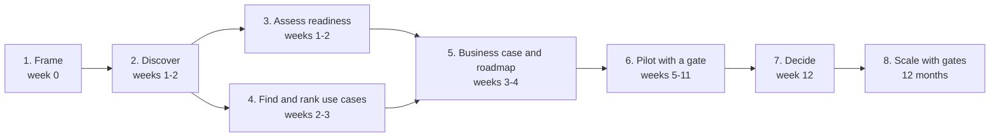

# AI transformation playbook

The method behind this case, written so it can be reused with the next client. It is opinionated on purpose: each step has an output that forces a decision.

## The arc

| Step | Output that forces a decision | Template | In this case |
|---|---|---|---|
| 1. Frame | Success criteria for the engagement, signed by the sponsor | — | [client brief](../00-engagement/client-brief.md) |
| 2. Discover | Measured baseline: volumes, handling time, error rate, shadow AI | [interview guide](templates/interview-guide-template.md) | [synthesis](../01-discovery/interview-synthesis.md) |
| 3. Assess readiness | Scored gaps, ranked by what they block | [questionnaire](templates/readiness-questionnaire.md) | [assessment](../02-ai-readiness/maturity-assessment.md) |
| 4. Find and rank | Agreed weights, ranked portfolio, robustness check, explicit "no" list | [use-case canvas](templates/use-case-canvas.md), [workshop agendas](templates/workshop-agendas.md) | [prioritization](../03-opportunity-discovery/prioritization.md) |
| 5. Business case and roadmap | Cash view vs capacity view; gates with kill criteria; owners | [business case checklist](templates/business-case-checklist.md) | [business case](../04-business-case/cost-benefit-analysis.md), [roadmap](../05-transformation-roadmap/12-month-roadmap.md) |
| 6. Pilot with a gate | Error budget and gate agreed *before* the build; ablation; held-out test set | — | [evaluation framework](../06-applied-ai/evaluation-framework.md) |
| 7. Decide | One staged ask, with the downside named | — | [proposal](../08-executive-presentation/proposal.md) |
| 8. Scale | Orchestration layer, inventory, literacy, portfolio refresh | — | [operating model](../05-transformation-roadmap/operating-model.md) |

## Ten rules we hold ourselves to

1. **No use case without an owner, a baseline and a number someone in the company believes.**
2. **Measure the baseline before promising an improvement.** Most companies do not know their handling time or error rate. Finding out is already valuable.
3. **Criteria before candidates.** Agree weights first, score second, and test whether the ranking survives other weights.
4. **Say no out loud.** A parked use case with its reason (high-risk, no owner, data not ready) prevents it from coming back through the side door.
5. **Separate capacity from cash.** Freed hours become euros only through a decision about people. Make that decision explicit and do it with HR and the works council.
6. **Agree the error budget before the build.** The business sets how many errors may pass unseen; the pilot is judged against that, not against "accuracy".
7. **Show what the naive version would have done.** An ablation is the clearest argument for the guardrails and the cheapest way to stop "just plug in a model".
8. **Never tune on the test set.** Choose thresholds on dev, report on test, and let the gate check that nobody hand-tuned.
9. **Governance is part of the delivery.** Policy, inventory, AI Act class and human oversight are roadmap items with owners, not an appendix.
10. **Leave a platform, not a pilot.** The second use case should cost a fraction of the first.

## Pitfalls we have seen

| Pitfall | What it looks like | Counter |
|---|---|---|
| Pilot purgatory | Five pilots, none in production | Gates with kill criteria; one use case at a time to production |
| Accuracy theatre | "96% accurate" with no definition of what an error costs | Error escape rate against an agreed budget |
| Vendor-led roadmap | The roadmap is the list of demos the company received | Score vendor ideas like any other; UC-08 here |
| Efficiency that never reaches the P&L | Hours saved, headcount unchanged, nobody decided what the hours are for | Cash view; attrition decision; CFO owns the dashboard |
| Governance as a blocker | Legal reviews everything at the end | Classification at registration; policy in week 1 |
| Shadow AI ignored | Policy bans tools, people keep using them | One sanctioned tool plus literacy, then the ban |

## Also in this folder

- [templates/](templates/): interview guide, readiness questionnaire, use-case canvas, workshop agendas, business case checklist
- [article: Stop counting pilots](article-stop-counting-pilots.md), a short thought-leadership piece based on this case
