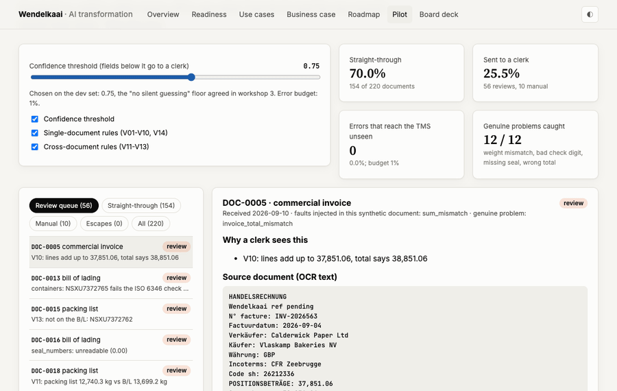

# Enterprise AI transformation: from readiness to measurable impact

**An end-to-end AI transformation case for a (fictional) 250-person logistics company in Zeebrugge.** It runs from the CEO's question to a board decision: discovery, AI readiness, a ranked use-case portfolio, a business case, a 12-month roadmap, a working document-AI pilot measured against a release gate, governance under the EU AI Act and ISO/IEC 27001, and the board pitch.

> *"Our board wants an AI plan by the end of the year. Competitors say they use AI. Where do we start, what is it worth, and how do we do it without getting into trouble?"* — the client's CEO

[](../../actions/workflows/ci.yml)
&nbsp;**Interactive site:** [overview](https://phlppgdfry.github.io/enterprise-ai-transformation/) · [pilot tour](https://phlppgdfry.github.io/enterprise-ai-transformation/pilot/?tour) · [board deck](https://phlppgdfry.github.io/enterprise-ai-transformation/deck/)



---

## The answer in one paragraph

**Start with the documents.** Eleven clerks retype about 4,000 freight documents a month, and 2.1% carry an error that costs money later. Of ten use cases scored with the leadership team, *freight document intelligence* ranks first under every weighting tried. The pilot reads each document, checks it against 14 business rules and routes it: straight into the TMS, to a clerk with reasons, or by hand. On 220 documents it never saw during tuning, <!--n:pilot.stp-->70.0%<!--/n--> go straight through with <!--n:pilot.escapes-->0<!--/n--> unflagged errors. **It is worth <!--n:bc.cash.npv-->€189k<!--/n--> over three years on the cash view** (payback <!--n:bc.cash.payback-->15 months<!--/n-->), and the biggest lever is a people decision, not the model. **Governance comes first:** readiness is <!--n:rd.overall-->1.9<!--/n--> of 5 (no AI policy, no inventory, 38% shadow AI), so policy, inventory, EU AI Act classification and the works council are in the first 90 days, and performance scoring of workers is parked as high-risk.

## What the case shows

| Question | Result | Where |
|---|---|---|
| Is the organisation ready? | <!--n:rd.overall-->1.9<!--/n--> of 5 (<!--n:rd.level-->Experimenting<!--/n-->), target <!--n:rd.target-->3.5<!--/n-->. Ready to *use* AI, not to *govern* it. | [Readiness](02-ai-readiness/maturity-assessment.md) |
| Where to start, and is that choice robust? | UC-01 freight document intelligence ranks first in <!--n:pf.UC-01.top1-->100%<!--/n--> of 2,000 random re-weightings of the criteria. | [Prioritization](03-opportunity-discovery/prioritization.md) |
| Does the pilot work? | Gate **<!--n:pilot.gate-->PASS<!--/n-->** on the held-out test set: <!--n:pilot.stp-->70.0%<!--/n--> straight-through, <!--n:pilot.escapes-->0<!--/n--> unflagged errors (budget 1%), <!--n:pilot.exceptions_caught-->100%<!--/n--> of genuine document problems sent to a person. | [Pilot results](06-applied-ai/pilot-results.md) |
| Would "just let AI read the documents" have worked? | No. Extraction alone puts <!--n:pilot.A.escapes-->36<!--/n--> of 220 documents into the TMS with an error. The clerks' own checks, written as rules, take that to <!--n:pilot.D.escapes-->0<!--/n-->. | [Ablation](06-applied-ai/evaluation-framework.md) |
| What is it worth? | Cash view: NPV <!--n:bc.cash.npv-->€189k<!--/n-->, payback <!--n:bc.cash.payback-->15 months<!--/n--> on <!--n:bc.one_off-->€85k<!--/n--> one-off. Capacity view: <!--n:bc.capacity.npv-->€232k<!--/n-->. If everything goes wrong at once: <!--n:bc.pessimistic.cash.npv-->-€142k<!--/n-->. | [Business case](04-business-case/cost-benefit-analysis.md) |
| What moves the value most? | <!--n:bc.tornado_top-->Doc desk leavers per year not replaced<!--/n-->, then <!--n:bc.tornado_top2-->Cost of one error that reaches operations<!--/n-->. The straight-through rate barely matters. | [Tornado](04-business-case/cost-benefit-analysis.md#what-moves-the-result) |
| Is it legal and safe? | Nothing in the plan is high-risk under the EU AI Act; UC-08 (worker performance scoring) is parked under Annex III 4(b). AI vendors go through the ISO/IEC 27001 supplier process. | [EU AI Act](07-governance/eu-ai-act-assessment.md) |

The pilot ran on synthetic documents built from a real-world fault mix, with an offline stand-in for the model; [EVIDENCE.md](EVIDENCE.md) separates what was executed, what was simulated and what was not done.

## Read it by role

| You are | Start with | Then |
|---|---|---|
| Executive (5 min) | [Executive summary](executive-summary.md) ([NL](samenvatting.md)) | [Board deck (PDF)](08-executive-presentation/board-presentation.pdf), [proposal](08-executive-presentation/proposal.md) |
| AI transformation lead / consultant | [Engagement approach](00-engagement/engagement-approach.md) | [Workshop series](01-discovery/workshop-series.md) · [readiness model](02-ai-readiness/maturity-model.md) · [playbook](09-playbook/README.md) |
| CFO / finance | [Business case](04-business-case/cost-benefit-analysis.md) | [Assumptions](04-business-case/assumptions.md) · [ROI workbook](04-business-case/roi-calculator.xlsx) |
| Operations / product owner | [As-is and to-be process](01-discovery/current-state-process.md) | [Human oversight](07-governance/human-oversight.md) · [change and adoption](05-transformation-roadmap/change-and-adoption.md) |
| Engineer / architect | [Pilot architecture](06-applied-ai/architecture.md) | [Evaluation framework](06-applied-ai/evaluation-framework.md) · [code](06-applied-ai/prototype/) |
| Legal / DPO / security | [EU AI Act assessment](07-governance/eu-ai-act-assessment.md) | [AI policy](07-governance/ai-policy.md) · [risk register](07-governance/ai-risk-register.md) · [ISO 27001 and 42001](07-governance/iso-27001-and-42001.md) |

## The nine deliverables

| Phase | Deliverables | What it proves |
|---|---|---|
| [01 Discovery](01-discovery/) | [Stakeholder map](01-discovery/stakeholder-map.md), [interview guide](01-discovery/interview-guide.md), [synthesis with measured baseline](01-discovery/interview-synthesis.md), [four workshops](01-discovery/workshop-series.md), BPMN [as-is](01-discovery/current-state.bpmn) / [to-be](01-discovery/future-state.bpmn) | Business first |
| [02 AI readiness](02-ai-readiness/) | [Model](02-ai-readiness/maturity-model.md), [assessment](02-ai-readiness/maturity-assessment.md), [gap analysis](02-ai-readiness/gap-analysis.md), [scorecard.xlsx](02-ai-readiness/readiness-scorecard.xlsx) | Judging an organisation |
| [03 Opportunities](03-opportunity-discovery/) | [Catalog of 10](03-opportunity-discovery/use-case-catalog.md), [matrix](03-opportunity-discovery/impact-feasibility-matrix.md), [prioritization + robustness](03-opportunity-discovery/prioritization.md), [scoring.xlsx](03-opportunity-discovery/use-case-scoring.xlsx) | Strategic choices that hold |
| [04 Business case](04-business-case/) | [Cost-benefit](04-business-case/cost-benefit-analysis.md), [assumptions](04-business-case/assumptions.md), [buy vs build](04-business-case/buy-vs-build.md), [ROI calculator.xlsx](04-business-case/roi-calculator.xlsx) | Financial insight |
| [05 Roadmap](05-transformation-roadmap/) | [90 days](05-transformation-roadmap/90-day-plan.md), [12 months](05-transformation-roadmap/12-month-roadmap.md), [RACI](05-transformation-roadmap/raci-matrix.md), [operating model](05-transformation-roadmap/operating-model.md), [change](05-transformation-roadmap/change-and-adoption.md) | Planning and ownership |
| [06 Applied AI](06-applied-ai/) | [Architecture](06-applied-ai/architecture.md), [evaluation framework](06-applied-ai/evaluation-framework.md), [results](06-applied-ai/pilot-results.md), [prototype](06-applied-ai/prototype/) | It works, measurably |
| [07 Governance](07-governance/) | [EU AI Act](07-governance/eu-ai-act-assessment.md), [risk register](07-governance/ai-risk-register.md), [human oversight](07-governance/human-oversight.md), [AI policy](07-governance/ai-policy.md), [ISO 27001/42001](07-governance/iso-27001-and-42001.md), [literacy](07-governance/ai-literacy-plan.md) | Responsible adoption |
| [08 Executive pitch](08-executive-presentation/) | [Board deck (PDF)](08-executive-presentation/board-presentation.pdf), [proposal](08-executive-presentation/proposal.md), [5-minute CEO walkthrough script](08-executive-presentation/demo-script.md) | Advising and convincing |
| [09 Playbook](09-playbook/) | [Method](09-playbook/README.md), [templates](09-playbook/templates/), [article](09-playbook/article-stop-counting-pilots.md) | Repeatable for the next client |

## Run it

Python 3.11+ and nothing else (Node is optional, for one check). No API key.

```bash
cd 06-applied-ai/prototype
python -m evals.run --gate                     # pilot: ablation, threshold sweep, test results, release gate
python -m freightdoc queue --set test          # the review queue a clerk would see
python -m freightdoc read DOC-0084             # one document end to end
cd ../..
python scripts/build.py                        # recompute readiness, portfolio, business case; refresh every number
python -m unittest discover -s tests -t .      # model, claims in the prose, Excel formulas, browser model
python -m http.server -d site 8000             # the interactive site on localhost:8000
```

With a real model: `pip install anthropic`, credentials via `ANTHROPIC_API_KEY` or `ant auth login`, then `--provider claude` (costs money per document; see the [prototype README](06-applied-ai/prototype/README.md)).

## How the repository keeps itself honest

- **One source of truth.** `model/*.json` (readiness, use cases, assumptions, roadmap, risks, RACI, stakeholders) plus the pilot's evaluation report. [`scripts/build.py`](scripts/build.py) computes everything and writes every number in the Markdown and HTML (`<!--n:key-->` markers), every generated table, the site data, the charts, the BPMN files and the Excel workbooks. CI runs `build.py --check` and fails on any drift.
- **Pilot numbers feed the business case.** The straight-through rate and its confidence interval come from the evaluation report, so a change to the pilot changes the business case in the same commit.
- **Claims are tested.** [`tests/test_model.py`](tests/test_model.py) checks sentences that are not generated (for example "places 2-5 are within 0.1", "the pessimistic case loses money", "36 escapes without the safety layers").
- **The Excel workbooks are verified.** A small formula evaluator recomputes the ROI workbook and checks it lands on the Python NPV.
- **The site cannot drift.** [`scripts/check_js.js`](scripts/check_js.js) runs the browser model against the Python results.
- **No tuning on the test set.** The release gate checks that the pipeline's configured threshold is the one the sweep picked on the dev set.

```
00-engagement/            client brief, engagement approach
01-discovery/ ... 09-playbook/   the nine deliverables (see above)
model/                    source data for the transformation model
engine/                   readiness, portfolio and business-case calculations (Python, stdlib)
06-applied-ai/prototype/  pilot: freightdoc package, prompts, schema, evals, data, tests
scripts/                  build, charts, BPMN, xlsx writer, link check, media rendering
site/                     interactive pages: overview, readiness, use cases, business case, roadmap, pilot, deck
tests/                    model, claims, workbook and site checks
```

## Honest limits

- **Fictional client.** Wendelkaai Logistics NV, its people, interviews, documents and numbers are invented. Regulations (EU AI Act incl. the Digital Omnibus, GDPR, Belgian collective agreements), standards (ISO/IEC 27001:2022, ISO/IEC 42001, ISO 6346, UN/LOCODE, Incoterms 2020) and methods are real; legal statements are a consultant's analysis, not legal advice.
- **Synthetic documents, offline model.** The pilot's 2 × 220 documents reproduce the fault types and rates of the (fictional) mailbox sample. The evaluated provider is a deterministic stand-in; the Claude provider is implemented and unit-tested with a fake client but not run against the API here.
- **No real engagement.** Workshops, interviews and the board meeting did not happen; the artefacts show how they would be run and what they would produce.
- **Built by one person, with AI assistance.** See [EVIDENCE.md](EVIDENCE.md) for exactly what was executed.
